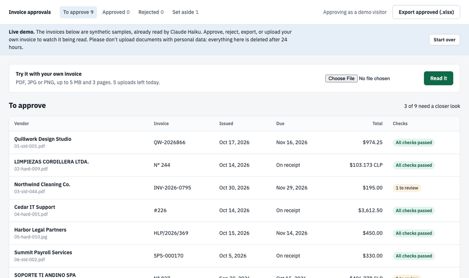
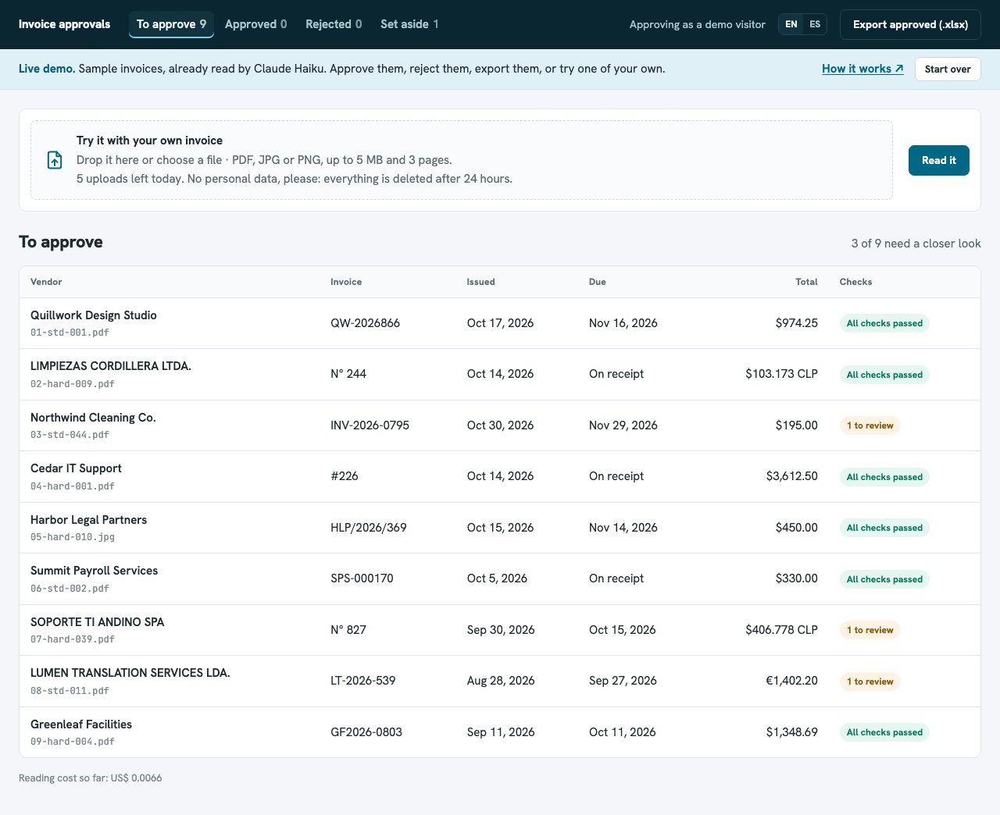
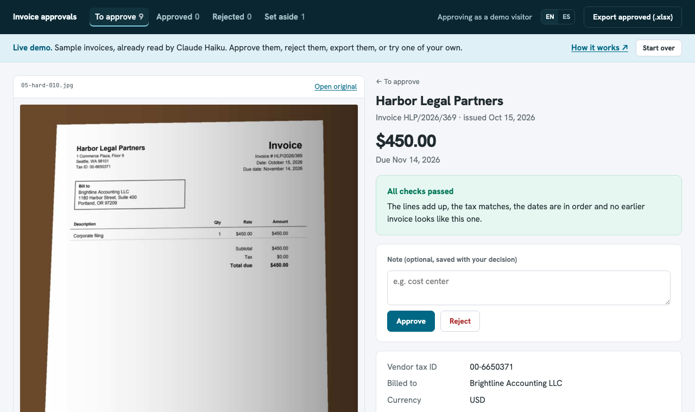
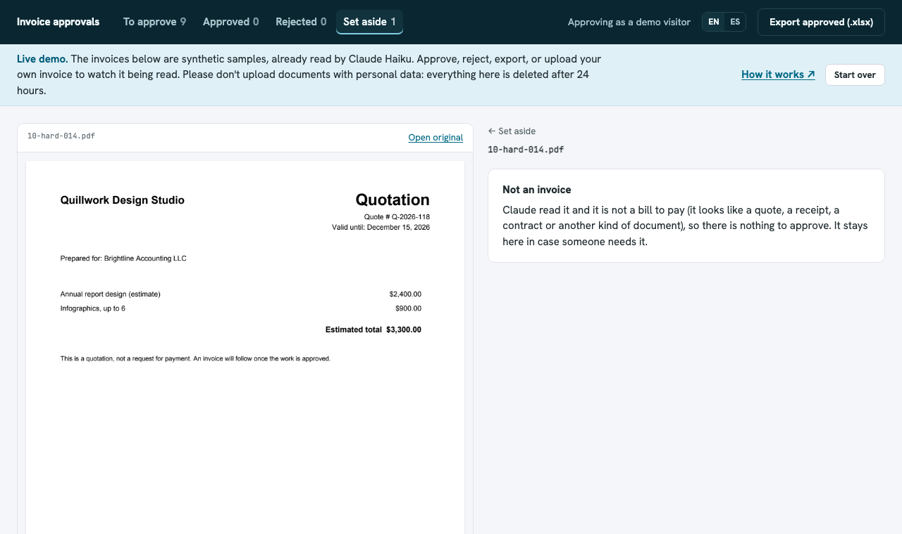
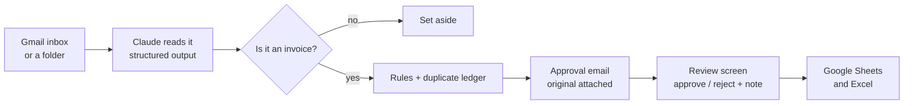

# Invoice AI pipeline

[](https://github.com/felipe-acb-01/invoice-ai-pipeline/actions/workflows/tests.yml)

**Vendor invoices arrive by email. This reads them with Claude, checks them with plain rules, asks a person to
approve each one, and writes the approved ones to a spreadsheet. Nobody types an invoice again.**

**[Try the live demo →](https://invoice-pipeline-demo-production.up.railway.app)** Ten sample invoices are already
in the queue. Approve or reject them, export to Excel, or upload an invoice of your own to watch it being read.



**[Watch the 70-second video (MP4)](docs/invoice-pipeline-demo.mp4)**: from the inbox to the spreadsheet, no voice-over.

## What it does

- **Reads PDFs, scans and phone photos**, in English, Spanish and Portuguese, with US, European and Chilean number
  and date formats, up to two pages.
- **Checks every invoice with rules an accountant can read:** the lines multiply out, the lines add up to the
  subtotal, subtotal plus tax is the total, Chilean IVA is 19 %, the due date comes after the issue date, the currency
  is one the company books in.
- **Catches duplicates across batches:** the same invoice sent twice (even as a new scan or photo), and the same charge
  under a new invoice number.
- **Every alert carries its numbers**, so the approver never redoes the arithmetic:
  *"The IVA should be $64.788 CLP (19 % of $340.990 CLP); the invoice says $65.788 CLP, $1.000 CLP too much."*
- **Sets aside what is not an invoice** (quotes, paid receipts, contracts, random photos) instead of inventing data for it.
- **Routes every invoice for approval:** an email with the original attached and a link to the review screen. The email
  never carries approve/reject links of its own, because mail scanners open links, and a scanner must never approve
  a payment.
- **Writes approved invoices to Google Sheets and Excel**, with who approved, when and why.
- **Never fails silently:** unreadable files go to their own tab and an alert goes out by email.

| The queue | A phone photo, read | Not an invoice |
|---|---|---|
|  |  |  |

## How it works



The model only **reads**: it fills a fixed schema with the values printed on the page and is told never to fix the
arithmetic. Everything that **decides** is a plain rule in [`validate.py`](src/invoice_pipeline/validate.py).

## Measured, not claimed

Two banks of synthetic invoices, each with the right answer, scored field by field
([`evaluate.py`](src/invoice_pipeline/evaluate.py), every failure printed in full):

| Bank | Model | Fields correct | Traps caught | False alarms | Cost per invoice | Time per invoice |
|---|---|---|---|---|---|---|
| Standard (60) | **Claude Haiku 5.5** | 720 / 720 | 5 / 5 | 0 / 55 | **US$ 0.0005** | 2.6 s |
| Hard (44) | **Claude Haiku 5.5** | 484 / 484 | 4 / 4 | 0 / 36 | **US$ 0.0007** | 3.9 s |
| Standard (60) | Claude Sonnet 5.5 · v1 prompt | 660 / 660 | 5 / 5 | 0 / 55 | US$ 0.0088 | 2.6 s |
| Standard (60) | Claude Opus 5.5 · v1 prompt | 660 / 660 | 5 / 5 | 0 / 55 | US$ 0.0177 | 3.0 s |
| Hard (40) | Claude Opus 5.5 · v1 prompt | 440 / 440 | 4 / 4 | 0 / 36 | US$ 0.0230 | 4.2 s |

- **Standard bank** (`samples/`): 40 clean PDFs in three layouts and three date conventions, 15 scans (skewed, noisy,
  no text layer) and 5 traps: a re-sent invoice, the same charge under a new number, a total off by 100, a line that
  does not multiply out, an invoice in euros.
- **Hard bank** (`samples_hard/`): Chilean electronic invoices (RUT, folio, IVA 19 %, Spanish dates), phone photos,
  two-page invoices, discounts and split taxes, unlabeled dates such as 08/12/2026 that only the address and payment
  terms settle, wrapped descriptions, four documents that are not invoices, and four traps (an invoice photographed
  twice, the same charge under a new folio, IVA off by $1.000, a subtotal that skips the last line on page 2).

**Decision: Claude Haiku 5.5.** It matched Opus field for field at about 1/30 of the cost: roughly **US$ 0.50–0.70
per thousand invoices**. The "v1" rows were measured before the not-an-invoice check existed.

**The honest limit:** these are computer-generated invoices; even photographed, their text is crisp. Handwriting,
faded thermal receipts or several invoices in one PDF are only measured with real documents, so the first week with
a client starts by running the same evaluation on a sample of theirs.

## Run it

```bash
python -m venv .venv && .venv/bin/pip install -e ".[dev]"
echo "ANTHROPIC_API_KEY=..." > .env

.venv/bin/python -m invoice_pipeline process --inbox inbox/      # read a folder of PDFs/photos into the queue
.venv/bin/python -m invoice_pipeline serve                       # review screen on http://127.0.0.1:8040
.venv/bin/python -m invoice_pipeline export approved.xlsx        # approved invoices to Excel
.venv/bin/python -m invoice_pipeline.evaluate --dry              # the evaluation, with the right answers ($0)
.venv/bin/pytest                                                 # 51 tests, no network
```

With Google (credentials in `secrets/`, see `python -m invoice_pipeline --help`):

```bash
.venv/bin/python -m invoice_pipeline authorize    # one-time Gmail consent
.venv/bin/python -m invoice_pipeline run          # Gmail → read → queue → approval emails → Sheets
```

Settings (environment or `.env`): `ANTHROPIC_API_KEY`, `INVOICE_MODEL` (default `claude-haiku-5-5`),
`BASE_CURRENCIES` (e.g. `USD,CLP`), `APPROVER_NAME`, `SHEET_ID`, `APPROVER_EMAIL`, `ALERT_EMAIL`, `APP_BASE_URL`.

## Design choices

- **The model reads, rules judge.** Structured outputs return the printed values in a fixed schema; every check is a
  rule a person can audit. A model never decides whether to pay.
- **Model choice comes from the evaluation**, re-run whenever the prompt or the schema changes (the cache is keyed by
  both, so an old answer is never reused for a new question).
- **Idempotent everywhere:** a file is read once (content hash), an approval email is sent once, a row reaches the
  sheet once (keyed by the document's fingerprint, not a database id).
- **The public demo costs nothing to open:** each visitor gets a private sandbox pre-filled with Haiku's recorded
  answers. Uploads are read live, within limits (5 per visitor, 60 per day, 5 MB, 3 pages) and deleted after 24 hours.

## Limitations

- Up to two pages per invoice; one invoice per file.
- Gmail access uses a desktop OAuth flow: for a production deployment the Google app needs verification, or the
  client's own Google Workspace.
- The approval screen has no login of its own; in production it sits behind the client's SSO or a reverse proxy.

All vendors, customers, tax IDs and amounts in `samples/`, `samples_hard/` and `demo_seed/` are invented. Each
document says so in its footer.
